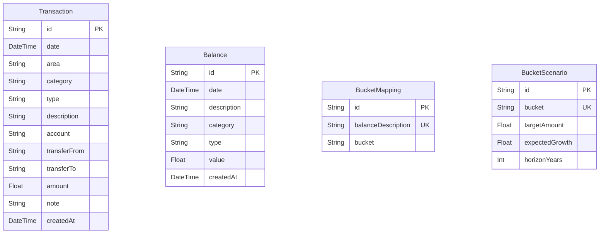

# SheetFinance: System Architecture & Improvement Plan

This document provides a comprehensive walkthrough of the **SheetFinance** codebase, its architectural components, database schema, data ingestion pipeline, and a detailed plan for future engineering improvements.

---

## 🏗️ System Architecture

SheetFinance is built as a unified web application using **Next.js 14 (App Router)**, **TypeScript**, and **Tailwind CSS**. It couples a local SQLite database using **Prisma ORM** with external integrations such as the **Google Sheets API** (for data backup and import) and the **Gemini API** (for automagical transaction classification).

### High-Level System Flow

The diagram below details the data flow between client-side views, backend API routes, the SQLite database, and external integrations (Google Sheets & Gemini AI).

```mermaid
graph TD
    %% Frontend Components
    subgraph Client [Client-Side UI]
        DashboardView["Dashboard (page.tsx)"]
        BucketsView["Four Buckets (buckets/page.tsx)"]
        WealthView["Wealth Ladder (wealth-ladder/page.tsx)"]
        SpendingView["Kassaflöde (spending/page.tsx)"]
        UploadView["Datahantering (upload/page.tsx)"]
        i18n["i18n Localization Context"]
    end

    %% Backend Routes
    subgraph Backend [Next.js API Routes]
        DashboardAPI["/api/dashboard"]
        BucketsAPI["/api/buckets"]
        WealthAPI["/api/wealth-ladder"]
        SpendingAPI["/api/spending"]
        UploadAPI["/api/upload"]
        CategorizeAPI["/api/categorize"]
        TransactionsAPI["/api/transactions"]
        ExportAPI["/api/export"]
        AuthAPI["/api/auth (NextAuth)"]
    end

    %% Database & External
    subgraph DB [Database Layer]
        PrismaClient["Prisma Client"]
        SQLite[("SQLite (dev.db)")]
    end

    subgraph External [External Services]
        GoogleSheets["Google Sheets API"]
        Gemini["Google Gemini 2.5 Flash API"]
    end

    %% Data Ingestion Connections
    UploadView -->|CSV Upload| UploadView
    UploadView -->|Raw Transactions| CategorizeAPI
    CategorizeAPI -->|Analyze Descriptions| Gemini
    Gemini -->|Categorized JSON| CategorizeAPI
    CategorizeAPI -->|Review Table| UploadView
    UploadView -->|Save Transactions| TransactionsAPI
    TransactionsAPI -->|Prisma Client| PrismaClient

    %% Traditional Google Sheets Inflow/Outflow
    UploadView -->|Sheets URL + Token| UploadAPI
    UploadAPI -->|Fetch Spreadsheets| GoogleSheets
    UploadAPI -->|Prisma client delete & createMany| PrismaClient
    UploadView -->|Sheets URL + Token| ExportAPI
    ExportAPI -->|Fetch DB Data| PrismaClient
    ExportAPI -->|Put Values| GoogleSheets

    %% Auth Connections
    UploadView -->|Trigger Login| AuthAPI
    AuthAPI -->|Retrieve Google AuthToken| GoogleSheets

    %% Database Connections
    PrismaClient <--> SQLite
    
    %% API to DB Queries
    DashboardAPI -->|Query Balances & Tx| PrismaClient
    BucketsAPI -->|Query Balances & Scenarios| PrismaClient
    WealthAPI -->|Query Balances & Tx| PrismaClient
    SpendingAPI -->|Query Tx| PrismaClient

    %% API to UI Data flow
    DashboardAPI -.->|DashboardData JSON| DashboardView
    BucketsAPI -.->|BucketsData JSON| BucketsView
    WealthAPI -.->|WealthData JSON| WealthView
    SpendingAPI -.->|SpendingData JSON| SpendingView
```



---

## 🗄️ Database & Schema Walkthrough

The project utilizes Prisma as an ORM to interact with a SQLite database (`prisma/dev.db`). The database schema is defined in [schema.prisma](file:///home/fredrik/Documents/GitHub/economy-overview/prisma/schema.prisma) and consists of four main models:



### 1. `Transaction`
* Represents individual banking transactions ingested from bank CSV files or a Google Sheet.
* Fields like `area` (e.g. *Utgift*, *Inkomst*, *Överföring*), `type` (e.g. *Mat & dryck*), and `category`/subtype (e.g. *Livsmedel*) represent the 3-tier taxonomy map.

### 2. `Balance`
* Represents balance sheet historical snapshots (Asset vs Liability values).
* Sourced from a user's `Balansräkning` sheet to track net worth, debt, and assets over time.

### 3. `BucketMapping`
* Maps balance sheet accounts (`balanceDescription`) to one of the four RikaTillsammans buckets: `BUFFER`, `PRESERVE`, `GROWTH`, or `PLAY`.
* Configurable on the mapping frontend page `/buckets/mapping`.

### 4. `BucketScenario`
* Stores targeted asset allocation profiles, compound growth rates, and investment timeframes for each b## 📁 Codebase Directory Structure

```
├── prisma/
│   ├── dev.db                       # SQLite Database file (ignored by Git)
│   └── schema.prisma                # Prisma Database Schema
├── src/
│   ├── app/                         # Next.js App Router Pages & APIs
│   │   ├── api/                     # Backend API endpoints
│   │   │   ├── auth/                # NextAuth Google authentication
│   │   │   ├── buckets/             # Scenarios and mappings endpoints
│   │   │   ├── categorize/          # Gemini API transaction classifier
│   │   │   ├── dashboard/           # Home dashboard analytics aggregator
│   │   │   ├── export/              # Google Sheets exporter
│   │   │   ├── reset/               # [NEW] Database reset and stats endpoint
│   │   │   ├── spending/            # Cashflow trend & category analyzer
│   │   │   ├── transactions/        # Transaction ledger queries & writers
│   │   │   ├── upload/              # Sheets ingestion sync endpoint
│   │   │   └── wealth-ladder/       # Passive income and tier calculator
│   │   ├── buckets/                 # Buckets View (Targets and Mappings UI)
│   │   ├── settings/                # [NEW] Settings panel page
│   │   ├── spending/                # Kassaflöde (Cashflow/Spending UI)
│   │   ├── upload/                  # Datahantering (Google Sheet Sync & AI UI)
│   │   ├── wealth-ladder/           # Wealth Ladder progression UI
│   │   ├── favicon.ico
│   │   ├── globals.css              # Global styling variables & utility classes
│   │   ├── layout.tsx               # Root layout wrapping sidebar & topbar
│   │   └── page.tsx                 # Dashboard home component
│   ├── components/                  # Shared React components
│   │   ├── LayoutWrapper.tsx        # [NEW] Client-side sidebar drawer manager
│   │   ├── Providers.tsx            # SessionProvider wrapper
│   │   ├── Sidebar.tsx              # Sidebar navigation (with slide drawer classes)
│   │   └── Topbar.tsx               # Header toolbar (with hamburger menu)
│   ├── lib/                         # Utility library files
│   │   ├── auth.ts                  # [NEW] Centralized auth configuration
│   │   ├── finance.ts               # [NEW] Unified financial business logic
│   │   ├── i18n.tsx                 # Localization provider (Swedish & English)
│   │   ├── preClassifier.ts         # [NEW] Local keyword pre-classification rules
│   │   └── prisma.ts                # Hot-reload safe global Prisma Client instance
│   ├── middleware.ts                # [NEW] Route protection middleware
├── .env.local                       # Environment credentials (ignored by Git)
├── package.json                     # Node dependencies & project scripts
└── tsconfig.json                    # TS configuration
```

---

## ✅ Implemented System Upgrades

The following optimizations have been fully implemented, compiling successfully with zero warnings/errors in the production build:

### 1. 🔒 Security & Session Protection
* **Session Wrapper**: Configured [auth.ts](file:///home/fredrik/Documents/GitHub/economy-overview/src/lib/auth.ts) to define and share `authOptions`.
* **API Validation**: Secured all endpoint query and mutation routes under `/api` by validating active NextAuth sessions.
* **Global Middleware Redirect**: Introduced [middleware.ts](file:///home/fredrik/Documents/GitHub/economy-overview/src/middleware.ts) to automatically intercept page loads and redirect unauthenticated users to the sign-in screen.

### 2. ⚡ Unified Business Logic Service
* **Finance Service**: Consolidated rolling spending calculations, average monthly expenses, solvency ratios, and runway computations into [finance.ts](file:///home/fredrik/Documents/GitHub/economy-overview/src/lib/finance.ts).
* **Database Aggregations**: Upgraded the calculations to use Prisma's native database aggregation (`_sum` and `groupBy`) instead of array reductions in Node memory.

### 3. 📱 Mobile Responsiveness Layout
* **Drawer Manager**: Created [LayoutWrapper.tsx](file:///home/fredrik/Documents/GitHub/economy-overview/src/components/LayoutWrapper.tsx) client shell to coordinate menu toggle states.
* **Responsive Navigation**: Added slide drawers, overlays, and hamburger toggles on [Sidebar.tsx](file:///home/fredrik/Documents/GitHub/economy-overview/src/components/Sidebar.tsx) and [Topbar.tsx](file:///home/fredrik/Documents/GitHub/economy-overview/src/components/Topbar.tsx).

### 4. 📅 Month/Year Filters & Ledgers Drill-down
* **Spending Filters**: Added year and month filter parameters to the spending API and integrated interactive selector dropdowns on the kassaflöde view.
* **Category Ledgers**: Implemented category drill-down details by fetching transactions from the transactions GET endpoint and showing them inside a visual modal sheet.

### 5. ⚙️ Settings Administration
* **Controls Dashboard**: Built the settings view page [settings/page.tsx](file:///home/fredrik/Documents/GitHub/economy-overview/src/app/settings/page.tsx) with statistics counts, logout triggers, and a database clear tool.

### 6. 🤖 Ingestion Optimization
* **Local Pre-classification Rules**: Built [preClassifier.ts](file:///home/fredrik/Documents/GitHub/economy-overview/src/lib/preClassifier.ts) to instantly resolve categories for common services (ICA, Swish, Netflix, Lön), skipping AI calls for known descriptions.
* **Prompt Batching**: Configured the categorization API to batch unclassified lines in chunks of 50 before sending them to Gemini 2.5 Flash, ensuring token compliance and parsing reliability.

---

## 🚀 Future Roadmap & Enhancements

For future development cycles, the following improvements are recommended:

* **Database Indexing**: Add index annotations in [schema.prisma](file:///home/fredrik/Documents/GitHub/economy-overview/prisma/schema.prisma) on transaction `date` and `area`, and balance `date` to optimize queries on large datasets.
* **Database-Backed Taxonomy**: Migrate the hardcoded taxonomy mapping from [upload/page.tsx](file:///home/fredrik/Documents/GitHub/economy-overview/src/app/upload/page.tsx) to database models to allow editing categories directly in the browser.
* **Hash-Based Deduplication**: Generate MD5/SHA256 hashes of transaction fields (amount, date, description) to handle identical transactions occurring on the same day without skipping valid separate purchases.
* **Few-shot Prompting**: Save category adjustments to database records, and feed user corrections back as few-shot training prompts to the Gemini classifier to improve categorization accuracy over time.
