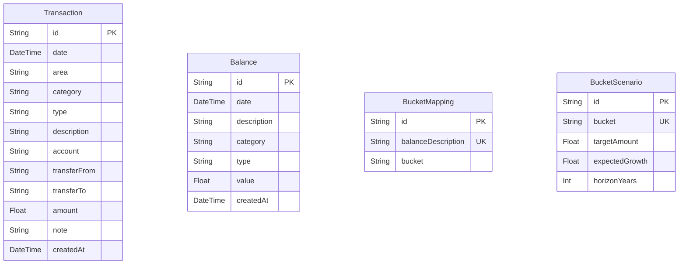

# SheetFinance: System Architecture & Improvement Plan

This document provides a comprehensive walkthrough of the **SheetFinance** codebase, its architectural components, database schema, data ingestion pipeline, and a detailed plan for future engineering improvements.

---

## 🏗️ System Architecture

SheetFinance is built as a unified web application using **Next.js 14 (App Router)**, **TypeScript**, and **Tailwind CSS**. It couples a local SQLite database using **Prisma ORM** with external integrations such as the **Google Sheets API** (for data backup and import) and the **Gemini API** (for automagical transaction classification).

### High-Level System Flow

The diagram below details the data flow between client-side views, backend API routes, the SQLite database, and external integrations (Google Sheets & Gemini AI).

```mermaid
graph TD
    %% Frontend Components
    subgraph Client [Client-Side UI]
        DashboardView["Dashboard (page.tsx)"]
        BucketsView["Four Buckets (buckets/page.tsx)"]
        WealthView["Wealth Ladder (wealth-ladder/page.tsx)"]
        SpendingView["Kassaflöde (spending/page.tsx)"]
        UploadView["Datahantering (upload/page.tsx)"]
        i18n["i18n Localization Context"]
    end

    %% Backend Routes
    subgraph Backend [Next.js API Routes]
        DashboardAPI["/api/dashboard"]
        BucketsAPI["/api/buckets"]
        WealthAPI["/api/wealth-ladder"]
        SpendingAPI["/api/spending"]
        UploadAPI["/api/upload"]
        CategorizeAPI["/api/categorize"]
        TransactionsAPI["/api/transactions"]
        ExportAPI["/api/export"]
        AuthAPI["/api/auth (NextAuth)"]
    end

    %% Database & External
    subgraph DB [Database Layer]
        PrismaClient["Prisma Client"]
        SQLite[("SQLite (dev.db)")]
    end

    subgraph External [External Services]
        GoogleSheets["Google Sheets API"]
        Gemini["Google Gemini 2.5 Flash API"]
    end

    %% Data Ingestion Connections
    UploadView -->|CSV Upload| UploadView
    UploadView -->|Raw Transactions| CategorizeAPI
    CategorizeAPI -->|Analyze Descriptions| Gemini
    Gemini -->|Categorized JSON| CategorizeAPI
    CategorizeAPI -->|Review Table| UploadView
    UploadView -->|Save Transactions| TransactionsAPI
    TransactionsAPI -->|Prisma Client| PrismaClient

    %% Traditional Google Sheets Inflow/Outflow
    UploadView -->|Sheets URL + Token| UploadAPI
    UploadAPI -->|Fetch Spreadsheets| GoogleSheets
    UploadAPI -->|Prisma client delete & createMany| PrismaClient
    UploadView -->|Sheets URL + Token| ExportAPI
    ExportAPI -->|Fetch DB Data| PrismaClient
    ExportAPI -->|Put Values| GoogleSheets

    %% Auth Connections
    UploadView -->|Trigger Login| AuthAPI
    AuthAPI -->|Retrieve Google AuthToken| GoogleSheets

    %% Database Connections
    PrismaClient <--> SQLite
    
    %% API to DB Queries
    DashboardAPI -->|Query Balances & Tx| PrismaClient
    BucketsAPI -->|Query Balances & Scenarios| PrismaClient
    WealthAPI -->|Query Balances & Tx| PrismaClient
    SpendingAPI -->|Query Tx| PrismaClient

    %% API to UI Data flow
    DashboardAPI -.->|DashboardData JSON| DashboardView
    BucketsAPI -.->|BucketsData JSON| BucketsView
    WealthAPI -.->|WealthData JSON| WealthView
    SpendingAPI -.->|SpendingData JSON| SpendingView
```



---

## 🗄️ Database & Schema Walkthrough

The project utilizes Prisma as an ORM to interact with a SQLite database (`prisma/dev.db`). The database schema is defined in [schema.prisma](file:///home/fredrik/Documents/GitHub/economy-overview/prisma/schema.prisma) and consists of four main models:



### 1. `Transaction`
* Represents individual banking transactions ingested from bank CSV files or a Google Sheet.
* Fields like `area` (e.g. *Utgift*, *Inkomst*, *Överföring*), `type` (e.g. *Mat & dryck*), and `category`/subtype (e.g. *Livsmedel*) represent the 3-tier taxonomy map.

### 2. `Balance`
* Represents balance sheet historical snapshots (Asset vs Liability values).
* Sourced from a user's `Balansräkning` sheet to track net worth, debt, and assets over time.

### 3. `BucketMapping`
* Maps balance sheet accounts (`balanceDescription`) to one of the four RikaTillsammans buckets: `BUFFER`, `PRESERVE`, `GROWTH`, or `PLAY`.
* Configurable on the mapping frontend page `/buckets/mapping`.

### 4. `BucketScenario`
* Stores targeted asset allocation profiles, compound growth rates, and investment timeframes for each bucket.

---

## 📁 Codebase Directory Structure

```
├── prisma/
│   ├── dev.db                       # SQLite Database file (ignored by Git)
│   └── schema.prisma                # Prisma Database Schema
├── src/
│   ├── app/                         # Next.js App Router Pages & APIs
│   │   ├── api/                     # Backend API endpoints
│   │   │   ├── auth/                # NextAuth Google authentication
│   │   │   ├── buckets/             # Scenarios and mappings endpoints
│   │   │   ├── categorize/          # Gemini API transaction classifier
│   │   │   ├── dashboard/           # Home dashboard analytics aggregator
│   │   │   ├── export/              # Google Sheets exporter
│   │   │   ├── spending/            # Cashflow trend & category analyzer
│   │   │   ├── transactions/        # Deduplication and database writers
│   │   │   ├── upload/              # Sheets ingestion sync endpoint
│   │   │   └── wealth-ladder/       # Passive income and tier calculator
│   │   ├── buckets/                 # Buckets View (Targets and Mappings UI)
│   │   ├── spending/                # Kassaflöde (Cashflow/Spending UI)
│   │   ├── upload/                  # Datahantering (Google Sheet Sync & AI UI)
│   │   ├── wealth-ladder/           # Wealth Ladder progression UI
│   │   ├── favicon.ico
│   │   ├── globals.css              # Global styling variables & utility classes
│   │   ├── layout.tsx               # Root layout wrapping sidebar & topbar
│   │   └── page.tsx                 # Dashboard home component
│   ├── components/                  # Shared React components
│   │   ├── Providers.tsx            # SessionProvider wrapper
│   │   ├── Sidebar.tsx              # Sidebar navigation
│   │   └── Topbar.tsx               # Header toolbar (locale switcher, search)
│   └── lib/                         # Utility library files
│       ├── i18n.tsx                 # Localization provider (Swedish & English)
│       └── prisma.ts                # Hot-reload safe global Prisma Client instance
├── .env.local                       # Environment credentials (ignored by Git)
├── package.json                     # Node dependencies & project scripts
└── tsconfig.json                    # TS configuration
```

---

## 📈 Detailed Improvement Plan

While the application features a robust functional architecture, there are several areas where code resilience, security, performance, and user experience can be dramatically improved.

### 1. 🔒 Security & Authentication
> [!IMPORTANT]
> **API Route Vulnerability**: Currently, none of the GET/POST API endpoints under `/api/buckets`, `/api/dashboard`, `/api/spending`, or `/api/transactions` perform authentication checks. Any user can scrape your financial data or modify your database transactions simply by querying the endpoints directly.

* **Secure API Routes**: Wrap endpoint bodies using `getServerSession(authOptions)` to block unauthorized queries.
* **Encrypt OAuth Tokens**: Keep the Google OAuth access token strictly on the server-side session instead of passing it down in the raw client session payload (`(session as any).accessToken`).
* **CSRF Protection**: Ensure state-modifying requests (like uploading transactions or updating configurations) carry CSRF tokens.

### 2. 🗄️ Database & Schema Optimization
* **Database Indexes**: Add database indexes on fields used for filtering and ordering (e.g. `date` and `area` on the `Transaction` table, and `date` on the `Balance` table) to boost query performance.
* **Configurable Taxonomy**: The transaction category taxonomy (`TAXONOMY` in `upload/page.tsx` and the Gemini prompt in `categorize/route.ts`) is hardcoded in the codebase. Moving this taxonomy into database models (e.g., a `TaxonomyNode` table) will let users customize categories directly inside the application.
* **Robust Deduplication**: The current transaction deduplication in `/api/transactions` checks for exact matches of `date`, `description`, and `amount`. This will skip valid duplicate transactions made on the same day (such as paying for two train tickets or coffees at the same shop). Implementing a transaction hashing mechanism or using unique transaction IDs provided by bank CSVs will eliminate false positives.

### 3. ⚡ Code Refactoring & Query Performance
* **Calculate Code Consolidation**: Rolling 6-month or 12-month expense aggregations, average monthly spending, and liquidity calculations are calculated independently (and slightly differently) in `/api/dashboard`, `/api/wealth-ladder`, and `/api/spending`. Extract these calculations into a unified business logic helper class (`/src/lib/finance.ts`).
* **Database Aggregations**: The endpoints currently fetch all matching transactions from the database and perform array reductions in Node JS memory (e.g. in `api/dashboard/route.ts` and `api/spending/route.ts`). Using Prisma's native `groupBy` and `_sum` functions will reduce the data transfer overhead and optimize memory usage.
* **SQLite Cloud Support**: SQLite is optimal for local execution, but fails under concurrent write loads in cloud environments. Abstracting database interactions allows swapping SQLite for a hosted alternative (like PostgreSQL, MySQL, or Turso) with minimal disruption.

### 4. 🎨 UI/UX & Feature Alignment
* **Mobile Responsiveness**: The sidebar navigation goes hidden on small screens (`hidden md:flex`), but there is no mobile drawer or hamburger trigger. The site is currently inaccessible on mobile devices. A mobile responsive menu needs to be added.
* **Missing Features implementation**:
  * **Month/Year Filters**: The requirements mention having filters to view specific months or years, which are currently not implemented on the dashboard or spending pages.
  * **Drill-down Table**: Users should be able to click on a spending category in `/spending` to see the transaction ledger details (the specific purchases that make up that category's total).
* **Settings Page 404**: The sidebar points to `/settings`, but no settings page or folder has been created in `/src/app`, resulting in a broken page link. A `/settings` page should be created to manage configurations, Google Sheet connections, and profile data.

### 5. 🤖 AI Categorization Enhancements
* **Prompt Batching**: Sending large CSV files with hundreds of transactions in a single prompt to Gemini may exceed token windows or degrade response structure validation. Splitting transaction payloads into smaller batches (e.g., 50 at a time) will improve reliability.
* **Local Regex Pre-classifier**: Querying Gemini for every bank transaction is slow and resource-heavy. Implementing a local lookup parser that matches common descriptions (e.g. `"Netflix" -> Nöjen`, `"Ica" -> Mat & dryck -> Livsmedel`) will bypass AI API calls for known recurring items, reducing latency.
* **Few-shot Prompting**: Ingest historical category corrections and inject them as few-shot training examples into the Gemini prompt to dynamically improve classification accuracy over time.
